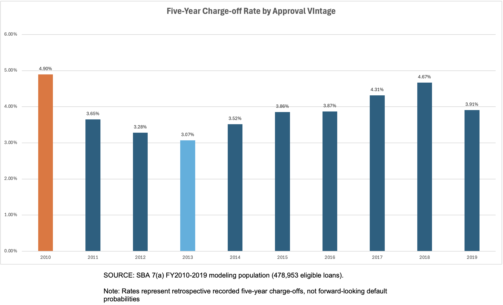
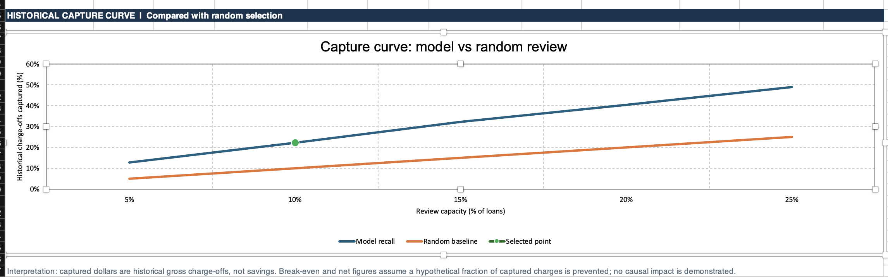

# 🏦 SBA 7(a) Banking Loan Risk & Portfolio Analytics

**PostgreSQL · Python · scikit-learn · Excel | Historical portfolio analysis and risk ranking**

I built an end-to-end portfolio analytics project using U.S. Small Business Administration (SBA) 7(a) loan records. I explored which segments recorded higher five-year charge-off incidence, compared two risk-ranking models, and developed an interactive Excel simulator to explore historical review capacity and hypothetical review costs.

| Modeling population | FY2019 holdout | Recall at top 10% | Precision lift vs. random |
|---:|---:|---:|---:|
| **478,953 loans** | **45,670 loans** | **22.28%** | **2.23×** |

## 📊 Project overview

**Business question:** Given limited review resources, can a historical loan-risk ranking identify a larger share of recorded charge-offs than reviewing loans at random? Which portfolio segments warrant closer analytical attention?

The dataset covers **FY2010–FY2019 approvals** in the SBA 7(a) FOIA release **as of June 30, 2026**. From 545,751 raw rows, I constructed a 478,953-row modeling population under a defined status and event-timing rule. I used a chronological split and selected a 13-predictor Logistic Regression after testing a Histogram Gradient Boosting challenger and investigating potential target leakage.

## 🔎 Key findings

**1. Risk ranking concentrates historical events, but the gain is modest.** Among 45,670 FY2019 loans, reviewing the 4,567 highest-scored loans (10%) would encompass **398 of 1,786 recorded five-year charge-offs (22.28%)**. That represents **2.23×** the event concentration expected from a random 10% sample. ROC-AUC was **0.7020**, and Average Precision was **0.0774**. The model's average predicted risk was **6.11%** against **3.91% observed**, so its scores are more useful as *relative rankings* than as trustworthy individual probabilities.

**2. Portfolio segments have sharply different observed event rates.** Across the retrospectively selected modeling population, loans **under $25,000** had a **6.313%** five-year charge-off rate versus **0.609%** for loans **$2 million and above**. Loans with an **85% SBA guarantee** had **7.733%** observed incidence versus **2.222%** for those with a **75% guarantee**. The 85% group had a **$100,000 median approval**, compared with **$510,000** in the 75% group. These comparisons are descriptive, and loan size, program mix, vintage, and guarantee terms may confound them; they do **not** imply that changing a guarantee percentage changes default risk.

**3. Recorded incidence varies by approval vintage.** Five-year event incidence ranged from **3.07% (FY2013)** to **4.90% (FY2010)** across the constructed modeling population. Vintage comparisons require caution because status selection and outcome maturity affect which loans can be observed.

**4. A suspiciously strong predictor changed the modeling approach.** Early models using reported loan term achieved unusually strong discrimination, and nonstandard terms showed abnormal event patterns. Because term values might reflect post-approval changes, I excluded both term-related predictors before the final comparison. **Leakage was suspected, not conclusively proven**; the underlying field-history mechanism has not been established.

### Portfolio segmentation — all FY2010–FY2019 eligible loans

I used PostgreSQL to compare processing methods, industry sectors and project states across **all 478,953 eligible loans** (18,826 recorded events). My analysis reports each segment’s event incidence, share of total loans, share of total recorded charge-offs, and early (**FY2010–2014**) versus late (**FY2015–2019**) event rates. The results describe a retrospective status-selected population, not prospective credit risk.

**Selection rule:** Each summary below shows the **five largest categories by loan count**, plus the highest and lowest *observed* rates among categories with **at least 5,000 loans and 100 recorded events**. Categories may appear in both groups. The full CSVs contain **every category**, including small and unknown groups; no categories are removed from the denominators. Processing methods have 24 categories, so the full listing is in the linked CSV rather than a 24-row README table. Extremely high or low rates selected from many categories may overstate the underlying differences.

**Processing method** — [all 24 categories](results/portfolio_processing_methods.csv)

| Category | Loans | Events | Event rate | Share of loans | Share of events | FY10–14 | FY15–19 |
|---|---:|---:|---:|---:|---:|---:|---:|
| SBA Express Program | 230,232 | 9,641 | 4.19% | 48.07% | 51.21% | 3.71% | 4.56% |
| Preferred Lenders Program | 153,392 | 4,660 | 3.04% | 32.03% | 24.75% | 2.01% | 3.64% |
| 7a General *(lowest qualifying rate)* | 37,718 | 1,030 | 2.73% | 7.88% | 5.47% | 2.91% | 2.51% |
| Small Loan Advantage Initiative | 27,648 | 1,396 | 5.05% | 5.77% | 7.42% | 4.79% | 5.22% |
| Patriot Express Loans | 5,553 | 504 | 9.08% | 1.16% | 2.68% | 9.08% | N/A |
| Community Express *(highest qualifying rate)* | 5,123 | 796 | 15.54% | 1.07% | 4.23% | 15.54% | N/A |

**NAICS industry sector** — [all 21 categories](results/portfolio_naics_sectors.csv)

| Category | Loans | Events | Event rate | Share of loans | Share of events | FY10–14 | FY15–19 |
|---|---:|---:|---:|---:|---:|---:|---:|
| Retail Trade | 65,659 | 2,962 | 4.51% | 13.71% | 15.73% | 4.67% | 4.37% |
| Accommodation and Food Services | 62,648 | 2,622 | 4.19% | 13.08% | 13.93% | 4.37% | 4.05% |
| Construction | 50,172 | 2,217 | 4.42% | 10.48% | 11.78% | 4.11% | 4.63% |
| Professional, Scientific and Technical Services | 47,322 | 1,731 | 3.66% | 9.88% | 9.19% | 3.22% | 4.04% |
| Health Care and Social Assistance | 44,706 | 1,023 | 2.29% | 9.33% | 5.43% | 2.05% | 2.50% |
| Transportation and Warehousing *(highest qualifying rate)* | 25,286 | 1,423 | 5.63% | 5.28% | 7.56% | 4.44% | 6.28% |
| Agriculture, Forestry, Fishing and Hunting *(lowest qualifying rate)* | 7,815 | 138 | 1.77% | 1.63% | 0.73% | 2.08% | 1.48% |

**Project state** — [all 57 categories](results/portfolio_project_states.csv)

| Category | Loans | Events | Event rate | Share of loans | Share of events | FY10–14 | FY15–19 |
|---|---:|---:|---:|---:|---:|---:|---:|
| California | 59,551 | 2,505 | 4.21% | 12.43% | 13.31% | 3.67% | 4.59% |
| Texas | 36,932 | 1,956 | 5.30% | 7.71% | 10.39% | 4.49% | 5.92% |
| New York | 30,838 | 1,229 | 3.99% | 6.44% | 6.53% | 3.34% | 4.46% |
| Ohio | 26,443 | 940 | 3.55% | 5.52% | 4.99% | 3.64% | 3.48% |
| Florida *(highest qualifying rate)* | 23,413 | 1,360 | 5.81% | 4.89% | 7.22% | 5.05% | 6.21% |
| Washington *(lowest qualifying rate)* | 12,754 | 315 | 2.47% | 2.66% | 1.67% | 2.80% | 2.21% |

The full population and both time bands reconcile independently for **each** dimension: **478,953 loans, 18,826 events; 210,806 early loans and 268,147 late loans**. NAICS groups use the existing SQL sector mapping, including Retail (44–45), Manufacturing (31–33), and Transportation/Warehousing (48–49). Some methods have no loans in one period; those rates are **N/A**, not zero. Processing method, loan size, vintage, sector and geography are intertwined, so neither observed rates nor the selected Logistic Regression coefficients establish causation.

**Reproducible analysis:** [SQL segment view and validation](sql/05_portfolio_segment_analysis.sql) · [psql export commands](sql/06_export_portfolio_segments_psql.sql) · [SQL execution notes](sql/README_SQL.md). The SQL uses `GROUP BY`, conditional aggregation, `UNION ALL`, and window functions to compute and validate the reports.

### Charge-off incidence by approval vintage

I calculated the fiscal-year loan counts and five-year charge-off rates using PostgreSQL, then built this visualization in Excel. The source data, formulas, and editable chart are available in the [SBA Vintage Analysis workbook](excel/SBA_Vintage_Analysis.xlsx).

*Source: FY2010–FY2019 loan counts and charge-offs from the 478,953-row modeling population. These are retrospective observed-label rates, not forward-looking default forecasts.*

## 💡 Recommendation and business use

The simulator is best used to **demonstrate how a lender might prioritize an enhanced-review queue for further evaluation**, not to deploy automated underwriting decisions. Before any live pilot, confirm approval-time feature provenance, build a historically realistic outcome population, address calibration and changes in interest-rate distributions, and evaluate operational feasibility. A prospective randomized comparison against a suitable control group would be needed to estimate whether reviewing loans actually prevents losses.

**Illustrative economics—not observed savings or projected ROI.** At FY2019's 10% review capacity, the model identifies 4,567 loans and **$15,416,819 in historical gross charge-off amounts** among the selected group. Holding that historical amount constant yields these *purely hypothetical* break-even percentages:

| Assumed cost per review | Cost for 4,567 reviews | Review cost ÷ historical gross charge-offs |
|---|---:|---:|
| $100 | $456,700 | **2.96%** |
| $500 | $2,283,500 | **14.81%** |
| $1,000 | $4,567,000 | **29.62%** |

The last column is a **hypothetical share of historical gross charge-off dollars that would have to be avoided to offset review cost**, *not* an empirically supported prevention probability. **Gross charge-off amounts do not distinguish the lender's loss from SBA's share and do not incorporate recoveries or net economic exposure.** Real review costs, intervention effects, payment timing, and preventability are unmeasured; therefore, these ratios cannot establish whether a review program is financially worthwhile.

## 📗 Interactive Excel simulator

**[Open the Excel risk-review simulator](excel/SBA_Risk_Review_Simulator.xlsx)** — a native Excel-for-Mac-compatible workbook with Dashboard, Capacity Analysis, Risk Deciles, Loan Data, and Methodology sheets. Select **FY2018 or FY2019** and **5%, 10%, 15%, 20%, or 25%** review capacity to compare historical event capture with a random-review baseline. The financial panel allows hypothetical review-cost and prevention-rate assumptions.

*FY2019, 10% review capacity: 4,567 historical loans selected, 398 recorded events captured.*

The workbook contains **99,864 FY2018/FY2019 loan-level rows and 11 analytical columns**, without borrower-name or street-address fields. Its main indicators are linked to **precomputed** cohort/capacity summaries; editing the Loan Data sheet does **not** automatically recompute them. No live Power Query source connection is required in the published copy.

## 🧠 Modeling and validation

| Cohort | Purpose | Loans | Five-year events |
|---|---|---:|---:|
| FY2010–2015 | Train | 266,226 | 9,894 |
| FY2016 | Tune | 56,785 | 2,198 |
| FY2017 | Fit probability calibration | 56,078 | 2,419 |
| FY2018 | Independent selection validation | 54,194 | 2,529 |
| FY2019 | Final frozen holdout | 45,670 | 1,786 |

| FY2018 uncalibrated model | Average Precision | ROC-AUC | Recall@10% | Events captured |
|---|---:|---:|---:|---:|
| **Logistic Regression (selected)** | **0.0941** | **0.7076** | 22.62% | 572 |
| Histogram Gradient Boosting | 0.0924 | 0.7030 | 23.13% | 585 |

Gradient Boosting did not meet my prespecified improvement requirements (**≥10% relative Average Precision** and **≥5 percentage points Recall@10%**, without materially worse calibration or stability). Paired bootstrap intervals for the improvement included zero, so I retained **uncalibrated Logistic Regression**, `C=1.0`, with **13 predictors**, before evaluating the final FY2019 cohort.

**Final FY2019:** 398 events among 4,567 reviewed loans; **22.28% Recall@10%**, **8.71% Precision@10%**, **0.0774 Average Precision**, **0.7020 ROC-AUC**. Brier score was **0.037618**, slightly worse than the constant training-prevalence baseline (**0.037581**). Observed incidence was **3.9107%** versus **6.1107%** mean predicted risk. This is a risk-ranking demonstration, **not a validated probability, pricing, or underwriting tool**.

I documented the outcome-definition reconciliation and the feature/audit analysis in [technical methods and reproducibility](docs/SBA_technical_methods_and_reproducibility.md), with further evaluation details in [model evaluation summary](docs/model_evaluation_summary.md).

## 🛠️ Technology and what I built

| Component | Implementation |
|---|---|
| SQL analysis | PostgreSQL, pgAdmin, `psql`; `raw` and `analytics` schemas, quality checks, four modeling views, a portfolio-segmentation view, cohort summaries |
| Python | pandas, NumPy, scikit-learn; preprocessing, Logistic Regression, Histogram Gradient Boosting, calibration and bootstrap analysis |
| Decision support | Excel (Mac-compatible); capacity analysis, historical event/dollar capture, deciles and what-if assumptions |
| Documentation | SQL scripts, eight numbered notebooks, saved model and selection record, supporting `docs/` and complete portfolio-segment CSVs |

## 🗃️ Data source and licensing

- **Source:** [U.S. SBA — 7(a) & 504 FOIA dataset](https://data.sba.gov/dataset/7a-504-foia). Select the **7(a), FY2010–FY2019, June 30, 2026** CSV to reproduce this project, along with the **7(a) and 504 FOIA data dictionary** on the same page. The SBA periodically updates its dataset; a different snapshot may produce different results.
- **Dataset terms:** The SBA catalog identifies the data as **U.S. Government Works**. The data belongs to its original source, not to this repository. The large source CSV and derived model-level exports are intentionally excluded from GitHub.
- **Project code:** The included [MIT License](LICENSE) applies to my original code and documentation. It does not change the SBA source dataset’s separate terms.

## 🔁 Reproduce the pipeline

1. Clone the repository, install **Python 3.12.8** and the pinned dependencies in `requirements.txt` (including **scikit-learn 1.5.1**).
2. Obtain the SBA FY2010–FY2019 CSV snapshot and place it under `data/raw/`. In PostgreSQL, run `sql/00_create_schemas.sql` and `sql/01_raw_database_setup.sql`.
3. In the **`psql` terminal**, run the exact **42-column `\copy` template** in [technical import instructions](docs/SBA_technical_methods_and_reproducibility.md#-postgresql-pipeline-and-sql-work), substituting your own CSV path. The import should produce **545,751 rows**. Run `sql/02_raw_data_validation.sql` and `sql/03_analytical_views.sql`.
4. Export `analytics.vw_sba_model_export` to `data/exports/sba_model_export.csv` (expected **478,953 rows × 25 fields**) and run notebooks **01–07** in order. `00_sba_feasibility.ipynb` is optional preliminary exploration. Details and SQL checkpoints are in [technical methods](docs/SBA_technical_methods_and_reproducibility.md).
5. For descriptive portfolio analysis, run `sql/05_portfolio_segment_analysis.sql` in pgAdmin, then regenerate the three published aggregated CSVs with `sql/06_export_portfolio_segments_psql.sql` in `psql` from the repository root (see [SQL execution notes](sql/README_SQL.md)).
6. Verify FY2019 results against the repository's `results/` and `models/model_selection_record.json`. Keep the original published model and result files backed up before rerunning notebooks that overwrite artifacts.

**Reproducibility:** I reran the SQL and Python pipeline using a fresh clone, separate PostgreSQL database, and isolated Python 3.12.8 environment, reproducing the final Logistic Regression results and FY2018 model-selection decision. Gradient Boosting showed small numerical differences, and the test does not prove byte-identical refitting of the saved final estimator; the published Excel file was also tested on Excel for Mac.

## ⚠️ Limitations and responsible use

- **Retrospective status selection and immature outcomes:** Some loans labeled `0` are not verified five-year survivors; a historical deployment would not have had every label available at the time. This is not a causal or production-ready underwriting evaluation.
- **Potential leakage:** Reported loan term was excluded, but approval-time provenance is not fully established for all retained inputs.
- **Calibration and drift:** FY2019 probabilities overpredicted recorded incidence. Interest-rate distributions and category labels changed across cohorts.
- **Operational claims:** Five-year recorded charge-offs are not the same as preventable losses. Neither this model nor the Excel what-if establishes savings from review.
- **Uncertainty:** Reported bootstrap comparisons resample loans, not lender clusters.

For exact target logic, event-boundary reconciliation, field definitions, interest-rate substitution sensitivity, and detailed SQL import instructions, see **[Technical methods and reproducibility](docs/SBA_technical_methods_and_reproducibility.md)**.

---

**Created by Parthasarathi Addala**
[GitHub: Parthuaddala](https://github.com/Parthuaddala)
