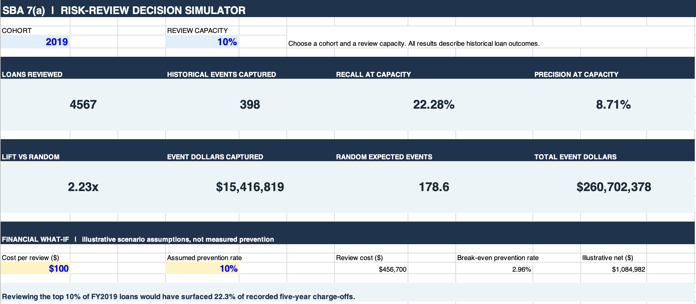
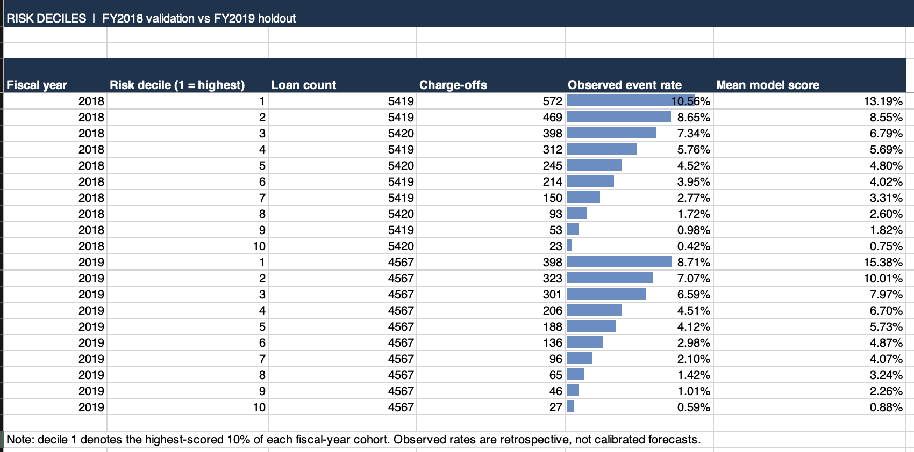

# 🏦 SBA 7(a) Banking Loan Risk & Portfolio Analytics

**PostgreSQL · Python · scikit-learn · Excel for Mac · Retrospective credit-risk ranking**

**A documented portfolio-analysis case study with historical risk ranking, careful model comparison, and a completed Excel decision-support simulator.**

| 📁 Modeling population | 🎯 FY2019 Recall@10% | 📈 FY2019 ROC-AUC | 🔍 Recorded events captured |
|---:|---:|---:|---:|
| **478,953 loans** | **22.28%** | **0.7020** | **398 of 1,786** |

**Explore:** [Overview](#-project-overview) · [SQL pipeline](#️-postgresql-pipeline-and-sql-work) · [Model selection](#️-model-selection-and-uncertainty) · [Holdout results](#-final-fy2019-holdout-frozen-model) · [Excel simulator](#-excel-risk-review-simulator-completed) · [Repository / setup](#-repository-structure-and-reproducibility) · [Limitations](#️-limitations-and-responsible-use)

### 🖼️ Excel simulator previews

**Risk-review dashboard — FY2019, 10% review capacity**



*At the selected 10% review capacity, 4,567 historical loans are reviewed and 398 recorded five-year charge-offs fall in this group. The financial what-if is illustrative, not demonstrated savings.*

**Risk deciles — FY2018 validation versus FY2019 holdout**



*Decile 1 is the highest-scored 10% of each fiscal-year cohort. The workbook displays historical observed event rates alongside uncalibrated model scores.*

## 📊 Project overview

This project analyzes U.S. Small Business Administration (SBA) 7(a) FOIA loan-level records approved in **FY2010–FY2019**, using a **June 30, 2026** data snapshot. It combines SQL-based ingestion and analytical views with Python validation, leakage investigation, chronological model comparison, and a frozen FY2019 holdout evaluation.

**Business question:** If a lender can review the highest-scored **10%** of historical loans, how much of the recorded five-year charge-off incidence would that group capture?

**Primary finding:** A 13-predictor, L2-regularized Logistic Regression captured **398 of 1,786** recorded FY2019 five-year charge-offs (**22.28% recall**) among **4,567 of 45,670 loans** (10% review capacity). Its **ROC-AUC was 0.7020** and **Average Precision was 0.0774** (1.98× cohort prevalence). However, its probability estimates **overpredicted** observed charge-off incidence, so this is a **retrospective risk-ranking exercise**, not a validated loan-approval or loss-forecasting system.

> **Scope warning:** The modeling population is selected using retrospectively observed loan statuses. Some field provenance remains unverified and five-year outcome labels from later vintages would not all have been observable when a truly historical model would have needed to be trained. Results do **not** establish real-world underwriting performance or that a review would prevent charge-offs.

## 🛠️ Technology and workflow

| Layer | Tools | Work performed |
|---|---|---|
| Data preparation | PostgreSQL, `psql`, pgAdmin | Import SBA CSV, standardize fields, build outcome/modeling views, audit statuses and dates |
| Analysis | SQL and Python (pandas, NumPy) | Cohort summaries, duplicate/missing-value investigations, feature-integrity checks |
| Modeling | scikit-learn | Logistic Regression baseline, Histogram Gradient Boosting challenger, sigmoid calibration |
| Validation | Python | Chronological splits, Average Precision, Recall@10%, Brier score, deciles, bootstrap comparisons |
| Reporting | Markdown and CSV | Methodology, frozen decision record, validation exports and exploratory diagnostics |
| Decision support | Excel for Mac | Completed FY2018/FY2019 risk-review simulator, capacity comparison, deciles, historical-dollar capture, and hypothetical review economics |

## 🗃️ Dataset and population

| Item | Count |
|---|---:|
| Original SBA FOIA data | **545,751 loans**, 42 source columns |
| Eligible modeling population | **478,953** |
| Recorded charge-offs within five calendar years | **18,826** |
| Target = 0 | **460,127** |
| Five-year event incidence | **3.9307%** |
| Unique modeling record IDs | **478,953** |
| Duplicate `loan_row_id` in modeling export | **0** |

**Eligibility:** Normalize source `LoanStatus = 'P I F'` to `PIF`; retain `PIF`, `EXEMPT`, and `CHGOFF`; exclude `CANCLD` and `COMMIT`. Exclude **10 CHGOFF records missing `ChargeOffDate`** because their event timing cannot be determined. `EXEMPT` indicates active/exempt status in the source, not proven five-year survival. The population is not the universe of loan applicants or even an unbiased sample of all approved loans.

### Exact target definition

`chargeoff_within_5yr = 1` when **all** of the following hold:

1. Normalized `loan_status = 'CHGOFF'`;
2. `chargeoff_date >= approval_date`;
3. `chargeoff_date <= approval_date + INTERVAL '5 years'` (**inclusive fifth calendar anniversary**);
4. `chargeoff_date <= snapshot_date` (June 30, 2026).

All other *eligible* rows are assigned `0`. The SQL uses **calendar intervals**, not 1,825 fixed days. Nine records with post-snapshot charge-off dates were flagged for audit; none qualify as an event on their post-snapshot date.

**Outcome reconciliation performed:**

| Window definition | Five-year events |
|---|---:|
| Selected: inclusive fifth calendar anniversary | **18,826** |
| Exclusive anniversary boundary | 18,813 |
| Fixed 1,825 days | 18,810 |

Exactly **13 events** fell on the fifth anniversary. An independent external review reported 478,963 rows and 18,821 events: the 10-row difference is explained by exclusion of missing charge-off dates; the remaining five-event discrepancy could not be attributed to the tested window conventions and is **unresolved** without its exact extraction logic and row identifiers. No data or models were changed to match it.

## 🐘 PostgreSQL pipeline and SQL work

The SQL phase is a substantive component of this project, not just a CSV export. We used the `raw` and `analytics` schemas and built an auditable progression from source records to the modeling export.

### 1. Raw import and quality validation

- Created a PostgreSQL database and `raw.sba_loans`, with **42 source fields** plus the persistent `loan_row_id` used to trace original rows.
- Loaded **545,751** SBA 7(a) rows with `psql`'s `\copy` workflow.
- Validated row counts, fiscal-year coverage, status distributions, relevant dates, duplicate occurrences, missing values, and abnormal terms.
- Found **1,136 exact source-row repeat occurrences** in the raw data. The modeling export retained a unique `loan_row_id` per row; that does **not** imply the underlying source contained no repeated loan information.
- Investigated missing/invalid charge-off and disbursement dates, date inconsistencies and post-snapshot charge-off records rather than silently dropping anomalies.

### Importing the raw CSV

Use the PostgreSQL `psql` client (not pgAdmin's plain SQL Query Tool) for `\copy`. The 42 source column names, in import order, are listed in `sql/01_raw_database_setup.sql`. The `loan_row_id` field is generated automatically and **must not** be included in the imported column list. Do not use bare `\copy raw.sba_loans FROM ...` with all fields because the raw table has a generated identity column. Execute the original verified 42-column import command locally, substituting your own CSV path. Never publish personal absolute paths or the raw borrower-level data. Verify **545,751** rows after import.

### 2. Clean analytical view — `analytics.vw_sba_loans_clean`

The retained PostgreSQL view definition was inspected directly. Its transformations include:

- Normalize `P I F` to `PIF`, trim other status text, cast date and numeric source fields.
- Compute `guarantee_pct = ROUND(100 * SBAGuaranteedApproval / NULLIF(GrossApproval, 0), 2)` and `unguaranteed_approval = GrossApproval - SBAGuaranteedApproval`.
- Map detailed `BusinessAge` source labels into common business-age groups; assign `Unknown` or `Unmapped` explicitly where appropriate.
- Group terms into duration categories (including invalid/zero terms) for **exploration only**.
- Derive NAICS sector using the first two digits of `NaicsCode` and sector mapping; standardize project state.
- Construct a lender identifier using FDIC number when available, otherwise NCUA number, otherwise normalized lender name, otherwise a row-specific unknown fallback. Flag records containing both FDIC and NCUA identifiers.

These are **descriptions of the existing view**, not instructions to execute a replacement view definition.

### 3. Five-year outcome view — `analytics.vw_sba_5yr_risk_population`

The outcome view joins the cleaned records to raw records on `loan_row_id`, retains eligible statuses, excludes charged-off records without a charge-off date, and derives:

- `chargeoff_date` and `snapshot_date`;
- `five_year_anniversary = (approval_date + INTERVAL '5 years')::date`;
- `chargeoff_within_5yr` under the four rules above;
- `post_snapshot_event_flag` for events after the dataset snapshot.

For example, the core **event-condition pattern** is:

```sql
CASE
    WHEN loan_status = 'CHGOFF'
     AND chargeoff_date >= approval_date
     AND chargeoff_date <= (approval_date + INTERVAL '5 years')::date
     AND chargeoff_date <= snapshot_date
    THEN 1 ELSE 0
END AS chargeoff_within_5yr
```

*Illustrative fragment only; see the actual saved SQL scripts or database view definition for executable SQL and its joins/casts.*

### 4. Modeling views and data export

- `analytics.vw_sba_model_candidates`: prepares model candidate fields and flags for assessment.
- `analytics.vw_sba_model_export`: supplies the final **25-column** dataset, including target, feature inputs, cohort labels, identifiers, and audit-only fields.
- Exported `data/exports/sba_model_export.csv` containing **478,953 × 25** rows/columns.
- Preserved the model-eligible population independently of post-holdout feature audits.

**Reviewed SQL scripts (in execution order):**

1. `sql/00_create_schemas.sql` — create `raw` and `analytics` schemas.
2. `sql/01_raw_database_setup.sql` — create the raw SBA table (42 source fields and generated `loan_row_id`).
3. Import the original SBA CSV with `psql` `\copy` (see below).
4. `sql/02_raw_data_validation.sql` — inspect raw counts, statuses, duplicate occurrences, missing values, amounts, and date anomalies.
5. `sql/03_analytical_views.sql` — create the four dependent views in order: clean, five-year population, model candidates, and model export.
6. `sql/04_exploratory_analysis.sql` — optional read-only portfolio/guarantee/NAICS analyses. This is the reviewed `Untitled.sql`, renamed because it belongs to this project.

The scripts were reviewed statically against the documented outputs; they have **not** been re-executed here against the local PostgreSQL database.

### 5. Representative SQL concepts demonstrated

`CREATE VIEW`, `CASE WHEN`, `NULLIF`, `TRIM`, numeric/date casts, `INTERVAL`, `LEFT()`/sector bucketing, derived columns, `JOIN`, conditional aggregation via `COUNT(*) FILTER (WHERE ...)`, `GROUP BY`, fiscal-year summaries, duplicate-row investigation, and auditing view definitions through PostgreSQL catalog metadata.

**SQL validation checkpoints:**

```sql
-- Final risk-population counts (read-only)
SELECT
    COUNT(*) AS loans,
    COUNT(*) FILTER (WHERE chargeoff_within_5yr = 1) AS events,
    COUNT(*) FILTER (WHERE chargeoff_within_5yr = 0) AS non_events,
    COUNT(*) FILTER (WHERE post_snapshot_event_flag = 1) AS post_snapshot_flags
FROM analytics.vw_sba_5yr_risk_population;
-- Observed: 478953, 18826, 460127, 9
```

```sql
-- Confirm fiscal-year event counts
SELECT approval_fy,
       COUNT(*) AS loans,
       SUM(chargeoff_within_5yr) AS events
FROM analytics.vw_sba_5yr_risk_population
GROUP BY approval_fy
ORDER BY approval_fy;
```

**Reproducibility caution:** `\copy` is a `psql` client command, not plain SQL executable in every pgAdmin query editor. Avoid committing personal absolute file paths; use documented configurable import locations.

## 🧠 Chronological model design

| Cohort | Role | Loans | Events | Incidence |
|---|---|---:|---:|---:|
| FY2010–2015 | Train | 266,226 | 9,894 | 3.7164% |
| FY2016 | Tune | 56,785 | 2,198 | 3.8707% |
| FY2017 | Fit probability calibrators | 56,078 | 2,419 | 4.3136% |
| FY2018 | Validate and freeze selection | 54,194 | 2,529 | 4.6666% |
| FY2019 | Final holdout | 45,670 | 1,786 | 3.9107% |

No later cohort was used to refit the selected Logistic Regression for the primary final evaluation. **Important historical realism limitation:** Training on FY2010–2015 labels to backtest FY2019 does not mimic what labels were fully matured by the start of FY2019.

### Final 13 predictors

**Numeric (4):** `gross_approval`, `guarantee_pct`, `initial_interest_rate_model`, `jobs_supported`.

**Categorical (8):** `business_age_group`, `naics_sector`, `project_state`, `processing_method`, `collateral_indicator`, `revolver_status`, `interest_rate_type`, `business_type`.

**Flag (1):** `invalid_interest_rate_flag`.

The model excludes `term_months_model` and `invalid_term_flag` following leakage diagnostics. The remaining fields are **provisional** pending verification that each field's value reflects the time of approval. Previously unseen business-age labels appeared in later cohorts, creating an additional generalization concern.

### Baseline and challenger

- **Logistic Regression:** median numeric imputation, scaling, one-hot encoding for categorical inputs, L2 regularization, `C=1.0`, `class_weight=None`, intercept enabled. Saved as `models/logistic_regression_13_features.joblib`.
- **Histogram Gradient Boosting:** nonlinear challenger with the same 13 candidate predictors; saved as `models/gradient_boosting_13_features.joblib`. Its categorical training-vocabulary conversion was implemented outside the saved estimator, so reproducing that challenger requires the associated notebook processing as well.
- **Sigmoid calibration:** fitted on FY2017; FY2018 diagnostics did not justify using calibrated Logistic Regression probabilities as the final artifact.

The prespecified challenger rule required **at least 10% relative improvement in Average Precision** **and** **at least +5 percentage points Recall@10%**, without materially worse calibration or stability. It did **not** satisfy these conditions on FY2018. The selected final artifact was the **uncalibrated Logistic Regression**; its calibration choice was informed by FY2018 and should not be treated as a separate untouched comparison.

### Leakage investigation: reported loan term

An early Gradient Boosting model with reported term achieved implausibly strong results. Permutation analysis identified term as overwhelmingly influential. Unusual, nonstandard loan terms had exceptionally elevated event incidence, raising concern that reported terms might incorporate post-approval servicing or modification information. The mechanism was **not proven**. Both term-related predictors were excluded from the primary comparison before final selection.

This is a central methodological finding: suspiciously good validation scores require investigating source-field semantics and timing, rather than automatically celebrating model performance.

## ⚖️ Model selection and uncertainty

**Independent FY2018 results (uncalibrated predictions):**

| Model | Average Precision | ROC-AUC | Recall@10% | Charge-offs captured | Brier |
|---|---:|---:|---:|---:|---:|
| Logistic Regression | **0.0941** | **0.7076** | 22.62% | 572 | 0.043512 |
| Gradient Boosting | 0.0924 | 0.7030 | **23.13%** | 585 | 0.043528 |

On 500 paired, loan-level bootstrap resamples, the **GB minus LR** difference had intervals:

- Average Precision: mean **−0.00205**, percentile 95% interval **[−0.00761, +0.00348]**.
- Recall@10%: mean **+0.45 pp**, percentile 95% interval **[−1.30, +2.25] pp**.

Both intervals include zero. This bootstrap does not account for loans clustered by lender and is not a lender-clustered confidence interval.

A frozen model-selection record is saved in `models/model_selection_record.json`.

## 📈 Final FY2019 holdout (frozen model)

| Metric | Result |
|---|---:|
| Loans / recorded events | 45,670 / 1,786 |
| Observed event incidence | 3.9107% |
| Average Precision (PR summary) | **0.0774** |
| Average Precision lift vs. prevalence | **1.98×** |
| ROC-AUC | **0.7020** |
| Review capacity | **Top 10% = 4,567 loans** |
| Recorded events in reviewed group | **398** |
| Recall@10% | **22.28%** |
| Precision@10% | **8.71%** |
| Precision lift vs. prevalence | **2.23×** |
| Mean predicted event probability | **6.1107%** |
| Brier score | **0.037618** |
| Brier reference: constant training prevalence | **0.037581** |
| Brier Skill Score | **−0.0984%** |

At a fixed 10% review capacity, the model concentrates ~22% of observed events in its top-ranked loans—approximately **2.23 times** the expected capture under random selection. These are *historical event counts*, **not** estimates of preventable losses or economic returns.

### Calibration limitation

FY2019 observed incidence was **3.9107%**, below the average predicted probability of **6.1107%** (a **+2.200 percentage-point** overprediction gap). All ten FY2019 score deciles overpredicted. In the highest-risk decile, the average prediction was **15.381%**, versus observed incidence of **8.715%** (gap **−6.667 pp**, using observed minus predicted). The Brier Skill Score is slightly negative relative to a fixed training-incidence benchmark. **Do not interpret raw model probabilities as trusted individual default probabilities.**

## 📗 Excel risk-review simulator

- **Dashboard:** Select FY2018 or FY2019 and a review capacity of **5%, 10%, 15%, 20%, or 25%**; compare historically observed charge-off capture against a random-review baseline, including the selected capacity marker on the chart.
- **Capacity Analysis:** Precomputed cohort/capacity summaries supply counts reviewed, recorded charge-offs captured, recall, precision, lift, and historically recorded charge-off dollars in the selected group.
- **Risk Deciles:** Compare observed event incidence and mean model score across ten score-ranked groups for each fiscal-year cohort.
- **Loan Data:** Contains **99,864 historical FY2018/FY2019 loan records** with 11 exported fields, sourced from `data/exports/sba_simulator_expanded.csv`.
- **Methodology:** Explains inputs, assumptions, metrics, and limitations.

At **FY2019 / 10%** capacity the workbook reports **4,567 reviewed loans**, **398 captured historical charge-offs**, **22.28% recall**, **8.71% precision**, and **2.23× precision lift**. These tie to the final evaluation.

**How the workbook updates:** Dashboard metrics use `INDEX/MATCH` to read the **precomputed Capacity Analysis table**, rather than recalculating model rankings and metrics from the full Loan Data sheet. Changing the fiscal-year/capacity selectors updates displayed summaries; manually changing Loan Data **does not automatically rebuild** those precomputed values. To refresh source data or scores, regenerate the exports and summary tables with the documented Python workflow. The financial what-if uses user-entered **cost per review** and an **assumed prevention rate**; outputs are scenarios, not observed prevention or established ROI. Historical gross charge-off amounts are descriptive and should not be interpreted as recoverable savings.

## 🔎 Exploratory post-holdout feature and drift audit

After the final test, further **diagnostics** were performed without retraining or reselecting the model. They are explanatory audits, **not** fresh independent validation.

| Retained feature | Audit finding |
|---|---|
| `gross_approval` | Loans under $25K: 6.313% incidence; loans $2M+: 0.609%. Loan size and portfolio mix likely confound this comparison. |
| `guarantee_pct` | 85% guarantee: 57,213 loans / 7.733% incidence; 75% guarantee: 161,081 / 2.222%. The 85% group is much smaller by median approved amount ($100K vs. $510K), and its elevated observed rate persists across approval fiscal years. |
| `initial_interest_rate_model` | At least 11%: 5,622 loans / 9.374% incidence. High rates are overwhelmingly concentrated in FY2018–2019; interest-rate distribution shifted over time. |
| `jobs_supported` | More supported jobs generally coincide with larger loans and lower incidence; 501+ group contains just six loans, unsuitable for strong inference. |
| `invalid_interest_rate_flag` | Seven missing modeled rates; all seven flagged correctly, no mismatches. |

**Training interest-rate range:** 0.660%–11.520%; FY2019 had 2,228 loans (**4.878%**) above that maximum. FY2019 median interest rate was 7.75%, compared with the FY2010–2015 training median of 6.00%. These are evidence of shifting inputs, **not** proof of leakage or causation.

### Mean predicted risk versus observed incidence by cohort

| Fiscal year | Observed | Predicted | Predicted − observed |
|---|---:|---:|---:|
| FY2016 | 3.871% | 3.648% | −0.222 pp |
| FY2017 | 4.314% | 3.741% | −0.573 pp |
| FY2018 | 4.667% | 5.153% | +0.486 pp |
| FY2019 | 3.911% | 6.111% | **+2.200 pp** |

The model was built **without class weighting** (`class_weight=None`); the frozen FY2019 Average Precision, ROC-AUC, mean prediction, and Brier score were reproduced in a compatible **scikit-learn 1.5.1** environment.

### Interest-rate substitution sensitivity (not a proposed recalibration)

Holding each later cohort's interest-rate input to the **6.00% training median** while leaving the other inputs unchanged gives:

| FY | Original predicted mean | Rate-fixed predicted mean | Original − rate-fixed |
|---|---:|---:|---:|
| 2016 | 3.648% | 3.087% | 0.561 pp |
| 2017 | 3.741% | 2.912% | 0.829 pp |
| 2018 | 5.153% | 3.467% | 1.686 pp |
| 2019 | 6.111% | 3.612% | **2.499 pp** |

This demonstrates the **fitted model's sensitivity** to the rate feature. It does **not** causally decompose the calibration gap, and the manipulated inputs can represent unrealistic combinations of features. The FY2019 evaluation remains unchanged.

## 📂 Repository structure and reproducibility

The following is the **intended published structure** after the final `.gitignore` audit. Large raw and modeling exports remain local and are **not** expected in the GitHub checkout.

```text
.
├── README.md
├── requirements.txt
├── .gitignore
├── assets/                             # Actual Excel simulator screenshots
│   ├── sba_dashboard.png
│   └── sba_risk_deciles.png
├── data/
│   └── README.md                         # Dataset source and local export instructions
├── sql/
│   ├── 00_create_schemas.sql
│   ├── 01_raw_database_setup.sql
│   ├── 02_raw_data_validation.sql
│   ├── 03_analytical_views.sql
│   ├── 04_exploratory_analysis.sql
│   └── README_SQL.md
├── notebooks/
│   ├── 00_sba_feasibility.ipynb
│   ├── 01_model_data_validation.ipynb
│   ├── 02_logistic_regression_baseline.ipynb
│   ├── 03_gradient_boosting_challenger.ipynb
│   ├── 04_probability_calibration.ipynb
│   ├── 05_independent_validation.ipynb
│   ├── 06_final_holdout_evaluation.ipynb
│   └── 07_feature_integrity_audit.ipynb
├── models/
│   ├── logistic_regression_13_features.joblib
│   ├── gradient_boosting_13_features.joblib
│   └── model_selection_record.json
├── results/
│   ├── fy2019_final_model_metrics.csv
│   ├── fy2019_calibration_deciles.csv
│   ├── annual_calibration_drift.csv
│   └── interest_rate_sensitivity.csv
├── excel/
│   └── SBA_Risk_Review_Simulator.xlsx
└── docs/
    └── model_evaluation_summary.md
```

Other retained model `.joblib` artifacts may be present locally; their inclusion depends on the final file-size and version audit. `data/raw/` and `data/exports/` hold local files, not files guaranteed to be present in the published repository. The intended `data/README.md` should be created and reviewed before publication.

**Suggested reproduction order:**

1. Use **Python 3.12.8** and install the pinned packages in `requirements.txt`, notably **scikit-learn 1.5.1**, NumPy 1.26.4, pandas 2.2.2, SciPy 1.13.1, joblib 1.4.2, matplotlib 3.9.2, openpyxl 3.1.5, and ipykernel 6.28.0.
2. Obtain the original SBA FY2010–FY2019 7(a) FOIA source **as of June 30, 2026** and its 42-field dictionary. A newer snapshot may give different figures. Place the source CSV locally in `data/raw/` and read the SQL import guidance.
3. Create PostgreSQL schemas and the raw table, import the 42-field CSV using **`psql` `\copy`**, then run the validation and analytical-view SQL scripts in `sql/` in the documented order.
4. Export `analytics.vw_sba_model_export` as **`data/exports/sba_model_export.csv`** (expected 478,953 records and 25 columns). This ~107 MB file is omitted from GitHub. The notebooks use relative paths and expect the data to be present locally.
5. Run the notebooks in numerical order **00–07** as appropriate. Notebook 00 is an exploratory feasibility check; notebooks 01–07 cover the modeling and evaluation pipeline. Rerunning notebooks that write artifacts can overwrite saved models/exports or refresh selection-record timestamps; back up published artifacts before full re-execution.
6. Compare final FY2019 metrics against `results/` and the frozen decision record. Notebook 07 also produces FY2018/FY2019 simulator data and supporting summaries; the released Excel workbook is a **precomputed historical review tool**, not an automatically regenerating modeling interface.

**Reproducibility limitations:** The published repository omits the 255 MB raw CSV and ~107 MB model export; the `psql` import remains a manual step. The reviewed SQL and notebook scripts have **not** been independently executed end to end on a fresh machine, so this is not a one-command reproduction. A local Python/Excel validation and saved-output audit were performed, but do not substitute for a clean-environment integration test. Do not publish personal absolute file paths or unnecessary borrower-identifying fields.

## ⚠️ Limitations and responsible use

- **Selection bias:** Eligibility is conditioned on retrospectively observed statuses. Some `0` records are not verified five-year survivors.
- **Timing and leakage:** Loan term was excluded due to leakage risk; approval-time provenance remains incomplete for some retained fields.
- **Maturity / temporal realism:** Outcomes observed by a 2026 snapshot do not necessarily reflect labels available when a model for FY2019 would have been deployed.
- **Outcome meaning:** Recorded charge-off within five calendar years is not the same as default, delinquency, loss severity, or preventable loss.
- **Calibration:** FY2019 probabilities materially overpredict incidence; a risk-ranking demo should not price credit or predict dollar savings from these probabilities.
- **Unseen categories / drift:** Historical cohorts differ in business-age categories and interest-rate distribution.
- **Data anomalies:** Source duplicates, invalid term/rate values and post-snapshot event flags require transparent handling.
- **Uncertainty:** Paired bootstrap samples individual loans, not lender clusters.
- **No causal claim:** Associations and counterfactual feature substitutions are descriptive, not evidence of interventions that reduce losses.

## ✅ Project status / next steps

**Completed:** SQL ingest and analytical views; modeling export; validation; Logistic Regression baseline; Gradient Boosting challenger; term-leakage investigation; probability calibration; FY2018 selection; FY2019 frozen evaluation; feature-integrity and drift diagnostics; **five-sheet Excel risk-review simulator tested on Excel for Mac**; preliminary notebook and SQL documentation reviews; Python dependency verification.

**Before GitHub publication:** (1) verify `.gitignore` and tracked-file size checks; (2) create/verify `data/README.md` and the exact raw-data acquisition/import instructions; (3) check that notebook links and relative paths still match the final layout; (4) optionally test the pipeline against a fresh PostgreSQL/Python installation. The project is not represented as fully reproduced end-to-end on a clean system.

---

*Methodology and metrics are based on the project SQL view definitions, model-evaluation summary, and recorded notebook outputs as reviewed through October 2026. The Excel workbook was separately validated on Excel for Mac. This is a research/portfolio demonstration, not an operational credit-decision tool.*
